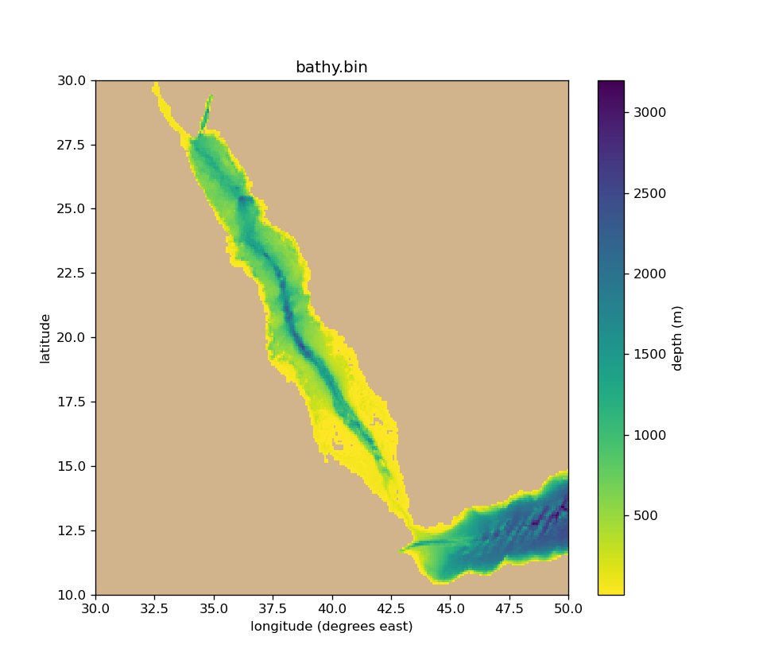

# gen_mitgcm_grid

Small Python scripts that make a **bathymetry file and grid settings for a
regional [MITgcm](https://mitgcm.org) model** from a global elevation dataset
such as ETOPO 2022 or GEBCO.

You edit a few settings at the top of a script (data file, box, resolution and
open sides) and run it. The script writes:

| File | What it is | Where it goes |
|---|---|---|
| `bathy.bin` | Depth on the model grid: big-endian `float32`, 0 = land, negative = depth in metres | `input/`, read through `bathyFile` |
| `data_grid.txt` | Ready-to-paste `&PARM04` / `&PARM05` grid namelists, `SIZE.h` sizes and `data.obcs` lines | copy into `input/data`, `code/SIZE.h`, `input/data.obcs` |
| `bathy_check.png` | Map of the result, for a quick visual check | — |

The grid is a regular latitude–longitude grid (`usingSphericalPolarGrid`).
Boxes that **cross the date line** are supported.



*Red Sea and Gulf of Aden at 0.08° (250 × 250), made by `gen_bathy_redsea.py`.*

## Scripts

| Script | Example domain |
|---|---|
| `gen_bathy_redsea.py` | Red Sea and Gulf of Aden, 30–50°E, 10–30°N, open eastern boundary |
| `gen_bathy_pacific.py` | Fiji–Tonga, 170°E–170°W, 25–5°S (crosses the date line), open on all sides |

Both scripts are the same code with different settings. Copy either one as a
starting point for a new region.

## Requirements

- Python 3 with `numpy`, `scipy` and `matplotlib`
- `netCDF4` to read NetCDF4 files (ETOPO 2022, GEBCO)

```bash
pip install numpy scipy matplotlib netCDF4
```

Older NetCDF3 files, such as ETOPO2v2, can be read without `netCDF4`.

## Getting the elevation data

Download a global ETOPO 2022 file from
[NOAA NCEI](https://www.ncei.noaa.gov/products/etopo-global-relief-model).
The examples use `ETOPO_2022_v1_60s_N90W180_surface.nc`.

- Choose the **surface** (ice-surface) version unless you are modelling
  ice-shelf cavities.
- Choose **geoid** heights, which are relative to mean sea level.
- Choose source data finer than your model grid. The 60″ file (~1.8 km) is
  fine for 0.08°; use the 30″ file for finer grids.

Elevation files (`*.nc`) are ignored by git, so you need to download your own.

## Usage

1. Open a script and edit the settings block:

   ```python
   ELEVATION_FILE = "ETOPO_2022_v1_60s_N90W180_surface.nc"

   LON_WEST, LON_EAST = 30, 50      # western edge first, then eastern edge
   LAT_SOUTH, LAT_NORTH = 10, 30

   RESOLUTION = 0.08                # degrees

   OPEN_SIDES = "E"                 # any of "N", "S", "E", "W", or "" for a closed box
   ```

   Two more settings sit just below the block: `MIN_DEPTH` (default 10 m) and
   `NUM_LEVELS` (default 50).

2. Run it:

   ```bash
   python3 gen_bathy_redsea.py
   ```

3. Check the printed summary (grid size, number of ocean cells, deepest point)
   and look at `bathy_check.png`.

4. Copy `bathy.bin` into your MITgcm `input/` directory and paste the lines
   from `data_grid.txt` into your MITgcm setup.

### Boxes across the date line

Give the western edge first and the eastern edge second, in any longitude
convention:

```python
LON_WEST, LON_EAST = 170, -170   # same box as 170, 190
```

The model grid runs continuously eastward from the western edge, so
`xgOrigin = 170` and the longitudes go from 170 to 190. MITgcm accepts
longitudes above 180. Use the same 0–360 convention when you make forcing
and open-boundary files for that model.

## What the script does

1. **Averages** all elevation points that fall inside each model cell, rather
   than interpolating to the cell centres. This avoids noise when the source
   data are much finer than the model grid.
2. **Sets a minimum depth.** Ocean shallower than `MIN_DEPTH / 2` becomes
   land, and anything between `MIN_DEPTH / 2` and `MIN_DEPTH` is deepened to
   `MIN_DEPTH`.
3. **Adds walls on closed sides.** MITgcm is periodic in x and y by default,
   so every side not listed in `OPEN_SIDES` gets a row or column of land.
4. **Keeps only the largest connected ocean region.** This removes lakes,
   land below sea level (e.g. the Danakil Depression) and seas cut off by the
   domain edge (e.g. the head of the Persian Gulf in the Red Sea box).
5. **Removes one-cell-wide dead-end inlets**, which often cause numerical
   problems.
6. **Builds `NUM_LEVELS` vertical levels.** They start at 5 m at the surface
   and thicken with depth, reaching just below the deepest cell.

## Notes and limitations

- **Narrow straits and sills.** Averaging onto a coarse grid can make straits
  too shallow or too narrow. Compare important sill depths (e.g. Bab
  el-Mandeb, about 137–160 m) with published values and edit `bathy.bin` by
  hand if needed.
- **Deep trenches** stretch the vertical grid. In the Tonga box the deepest
  point is about 10.5 km, so the bottom levels become several hundred metres
  thick. Increase `NUM_LEVELS` if that matters for your problem.
- **Tile layout.** `data_grid.txt` gives `Nx`, `Ny` and `Nr`. You still choose
  `sNx`, `nPx`, `sNy` and `nPy` in `SIZE.h` so that `sNx*nPx = Nx` and
  `sNy*nPy = Ny`.
- **Open boundaries.** The `data.obcs` lines only mark where the boundaries
  are. You still need to make the boundary-condition files (u, v, T, S) and
  enable the OBCS package.
- **Memory for date-line boxes.** For a box across the date line, the script
  reads the full width of the file for your latitude band. That is about
  400 MB for a 20°-tall band from the 30″ file.
- **Grid type.** Only regular latitude–longitude grids are supported. Polar
  stereographic and other curvilinear grids need a different approach.
